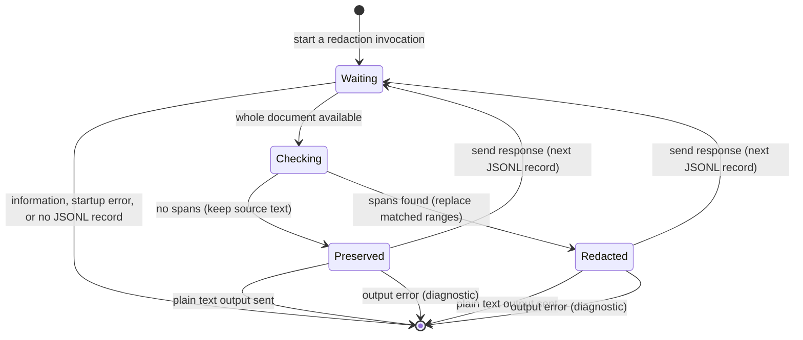

# Detection

## Summary

Redakt recognizes formatted private values and values introduced by a cue, such as a name after `name:` or a date after `DOB:`. It runs both forms of recognition automatically in plain text and JSONL. JSONL lets you inspect what it found in the original document.

## The simple case

Send `Contact: a@example.test` and `DOB: 2000-02-29` on separate lines of a plain text document. Redakt replaces the email and birth date with `[EMAIL_1]` and `[DATE_1]`, preserving the field names and line endings.

An equivalent JSONL record returns the same redacted document plus the two spans. Their offsets address the original text, so you can use them to see which characters each category matched.

## The interaction, event by event

### Invoke

Provide input through [plain text](plain-text.md) or [JSONL](jsonl.md). With embedded weights, redakt uses the seven model categories below in addition to the built-in cue-based recognition.

### Exit immediately

An information command, startup error, or rejected input ends its path before recognition. Empty documents have no spans. A blank JSONL line is skipped before a document exists.

### Begin running

Redakt checks a complete [document](../foundations/documents.md). In plain text that means all the text up to EOF. In JSONL it means the decoded `text` of one valid record.

Recognition finds values based on their syntax and surroundings. It can leave private values visible or replace public values that fit a detected pattern.

### While running

These examples illustrate the model categories with embedded weights. The surrounding text can affect whether a candidate qualifies.

| Category | Recognized example | Boundary to expect |
| --- | --- | --- |
| `email` | `nora+receipts@sub.example.test` | An internationalized local part in `müller@example.test` and a quoted local part in `"nora chen"@example.test` are left visible. |
| `phone` | `+1 (212) 555-0123` | Recognizes US-style numbers such as `212-555-0123` and `303.555.0128`. Bare `2125550123` and `+44 7700 900123` are left visible. |
| `ssn` | `123-45-6789` | Requires dashes and excludes invalid groups, for example the `000` area in `000-12-1234` and `00` in the middle of `123-00-1234`. |
| `card` | `4111 1111 1111 1111` | Contiguous digits and supported spaces or hyphens work. Invalid Luhn checksums and repeated single-digit sequences such as `0000000000000` are left visible. |
| `iban` | `GB82 WEST 1234 5698 7654 32` | Requires uppercase letters, a matching country length and checksum. Embedded coverage is GB, DE, FR, ES, NL, and IT. |
| `name` | `Patient Amelia Rivers arrived.` | Can replace `Amelia Rivers` after this cue with the embedded weights alone. `I met Amelia Rivers yesterday.` leaves the name visible. |
| `address` | `Address: 42 Maple Street.` | Leaves terminal punctuation outside the match. It can include later city, region, and postal fields in recognized layouts such as `Lives at 7 Oak Lane, Boston, MA 02108.`. |

The cue-based pass recognizes the following values even when file weights omit the corresponding model coverage. Cue words match ASCII letters case-insensitively. A cue needs a boundary and typically precedes the value with `:`, `=`, or a space-separated `is`. `ship to` and `lives at` also work with a space or tab before the address. Matching single or double quotes can surround a cue or value.

| Category | Cue examples | Accepted value |
| --- | --- | --- |
| `name` | `name`, `full name`, `my name`, `patient`, `customer` | One to four words, at most 100 code points. Accepts Unicode letters with internal apostrophes or hyphens, and excludes common words such as `the` and `said`. |
| `address` | `address`, `ship to`, `lives at` | A street-only value of three to eight parts. Starts with ASCII digits and ends with a supported suffix such as `Street`, `Rd`, or `Lane`, without requiring title case. |
| `secret` | `password`, `passwd`, `api_key`, `api key`, `access_token`, `access token`, `client_secret`, `client secret` | One unquoted token or a quoted passphrase. Periods, colons, and equals signs can be part of a secret. Backslashes and control characters invalidate it. |
| `account_number` | `bank account`, `account number` | Six to 34 ASCII digits, optionally separated by spaces, tabs, or hyphens. The first and last characters are digits. |
| `date` | `dob`, `date of birth`, `birth date` | A valid calendar date in `YYYY-MM-DD`, `DD/MM/YYYY`, or `MM/DD/YYYY` form with a nonzero four-digit year. A slash form qualifies if either day and month interpretation is valid. |

The cue-based pass stays within a line and rejects value candidates longer than 256 code points. A closing quote must match the opening quote. A comma, semicolon, closing bracket, or closing brace can end an unquoted value. Periods can end unquoted values other than secrets. A space or tab ends an unquoted secret or birth date. Side-by-side recognized fields can be read separately, as in `name: ada green password: example-only`.

See the [supplemental coverage rules](../../contextual.md#supplemental-coverage) for the full suffix list, and the [frozen matching fixtures](../../../tests/fixtures/rules-parity.jsonl) for more model layouts and boundary examples.

### Finish

A document can have spans from both forms of recognition. For `password: a@example.test`, JSONL reports `email` and `secret` over the same range, and the redacted text has one placeholder. The [document model](../foundations/documents.md#while-running) owns span order, overlap, and placeholder numbering.

## Modifiers

| Modifier | At startup | Changed while running |
| --- | --- | --- |
| Help and version | Exits without inspecting a document. | No effect. |
| `--jsonl` | Makes spans visible and accepts one document per record. | No effect. |
| `--weights PATH` | Can change matches supplied by the model. Built-in cues still apply. | No effect after loading. |
| Terminal or pipe | Identical document bytes are checked the same way. | EOF or output closure follows the selected input mode. |

## Cancel and interrupt

| Event | At startup | While running |
| --- | --- | --- |
| Ctrl+C (once or twice) | A delivered SIGINT can end startup. | Stops recognition or output. Previously delivered responses remain. |
| SIGTERM | A delivered SIGTERM can end startup. | Stops recognition or output without rollback. |
| Terminal closes (SIGHUP) | A delivered SIGHUP can end startup. | Stops recognition or output without rollback. |
| Stdin closes (EOF) | Buffered input can still be checked. | Defines the end of plain text or supplies the final JSONL record. |
| Stdout pipe closes | No effect on recognition rules. | A match can be found without reaching the reader. |
| Network drops | No effect for local streams. | No effect for local streams. |
| Disk full or file inaccessible | Redirection or model errors can prevent recognition. | Input or output errors can prevent a result. |
| Source file changes | Can affect bytes available to read. | Can affect unread input. Already loaded weights stay in use. |
| Second invocation | Starts independently. | Has its own documents and model selection. |
| Process killed outright | The process stops immediately. | Already delivered bytes remain. |

## Interactions with other systems

**Configuration.** The embedded model is the default. Selecting [file weights](weights.md) changes the model portion of recognition.

**Streams and Unicode.** Cues have ASCII spellings. Values can include Unicode letters where the category allows them. A recognized value's span still uses code points regardless of the input mode.

**Exit and diagnostics.** Finding no spans is normal and can exit successfully. A successful redaction status says nothing about whether the text contains private data.

**Files and permissions.** Redakt reads the chosen model with the caller's permissions and checks the document already supplied through stdin.

**Concurrency.** Recognition and numbering for concurrent invocations are independent.

**Offline use.** Both forms of recognition run locally.

## Edge cases

- A checksum-valid public product identifier can be replaced as a card. `Product name: Maple Editor` can also match the `name` cue. See the [accuracy evaluation](../../accuracy.md#observed-baseline) for observed false positives and misses.
- A syntactically valid IBAN followed by a space and an uppercase word can be left visible. The candidate can include the following word and fail the length or checksum without trying a shorter match. For example, `IBAN: GB82WEST12345698765432 NEXT` is unchanged, while `next` in place of `NEXT` leaves the IBAN eligible for replacement.
- Private URLs, names without cues, and many international addresses can remain visible. A street-only match can leave the rest of an address visible.
- Cue-based recognition does not interpret escape sequences in a document value. JSONL escaping that belongs to the transport is decoded before recognition.

## Open questions and verification

- An exclamation mark at the end of a street address after a lowercase cue can leave the address visible. The same applies to a cued birth date. Compare `address: 42 Maple Street!` with `address: 42 Maple Street.` and `DOB: 2000-02-29!` with `DOB: 2000-02-29.`. See [triage B-03](../bug-triage.md#b-03-exclamation-marks-block-cued-address-and-date-recognition).
- The `name` cue in `Product name: Maple Editor` redacts a product title. See [triage B-04](../bug-triage.md#b-04-a-product-title-can-be-redacted-as-a-persons-name).
- The [accuracy evaluation](../../accuracy.md) uses selected synthetic documents. The fixture results do not establish coverage for other data.

Verified against redakt commit `6ba6de0`
