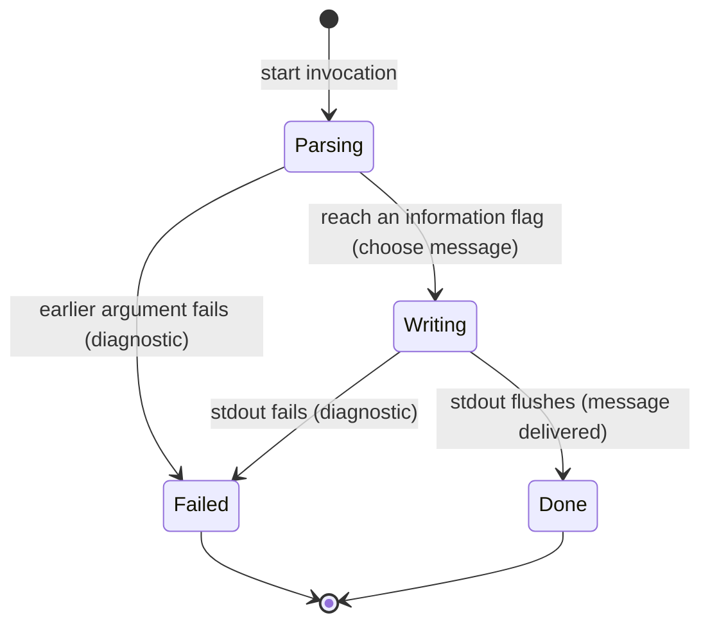

# Help and version

## Summary

Use `redakt --help` for the command synopsis or `redakt --version` to identify the executable. Both are available offline and work from a terminal, in a pipeline, or in a build script.

## The simple case

Run `redakt --help`. The first line reads `redakt [--weights PATH] [--jsonl]`. The rest describes plain text input, numbered placeholders, recognized categories, JSONL responses, and code-point offsets.

Then run `redakt --version`. The executable covered here prints `redakt 0.0.5`. Both commands return control to the shell after writing one newline-terminated message to stdout.

## The interaction, event by event



### Invoke

Pass `-h` or `--help` for help, and `-V` or `--version` for the version. An option encountered earlier must parse successfully for redakt to reach the flag. See [argument parsing](../foundations/invocation.md#invoke).

### Exit immediately

The first information flag encountered as an option chooses the message. A flag swallowed as a weights path never reaches this step. Any tokens after the chosen flag are ignored. Startup ends here, before redakt loads weights or reads stdin.

These are different commands:

```bash
redakt --version --unknown
redakt --unknown --version
```

The first prints the version. The second reports the argument error with no version output.

### Begin running

There is no document-processing phase. The information command proceeds straight to stdout. It reports neither model readiness nor the presence of a supplied weights path.

For example, `redakt --weights missing.bin --version` can identify the executable even though the corresponding redaction invocation would fail during model startup.

### While running

The message is written and flushed as part of the immediate exit path. There is no interactive prompt or progress output. Keeping stdin open has no effect.

If a reader closes stdout before the message can be delivered, the write or flush can fail. If the reader closes stdout after a successful flush, redakt has already finished its part.

### Finish

A successfully flushed message gives exit status 0 and empty stderr. A failed write or flush returns status 1 with `redakt: Could not write command information` on stderr when stderr is writable.

The invocation stores no settings. To check a different executable, run that executable with the version flag.

## Modifiers

| Modifier | At startup | Changed while running |
| --- | --- | --- |
| Help and version | Selects the first information option reached. | No effect. |
| `--jsonl` | A single occurrence before the information flag parses successfully. The information message is still text. | No effect. |
| `--weights PATH` | Consumes the next token before scanning for the information flag. | No effect. |
| Terminal or pipe | Either receives the same message. A closed pipe can fail the write. | Losing the destination can fail the write or flush. |

## Cancel and interrupt

| Event | At startup | While running |
| --- | --- | --- |
| Ctrl+C (once or twice) | A delivered SIGINT can end the process. | A delivered SIGINT can cut writing short. There is no second-stage abort. |
| SIGTERM | A delivered SIGTERM can end the process. | The process can end before delivery. |
| Terminal closes (SIGHUP) | A delivered SIGHUP can end the process. | The process can end before delivery. |
| Stdin closes (EOF) | No effect. | No effect. |
| Stdout pipe closes | An ensuing message write can fail. | A write or flush fails if it reaches the closed pipe. |
| Network drops | No effect for local streams. | No effect for local streams. |
| Disk full or file inaccessible | A failed shell redirection can prevent launch. The weights path is unopened. | Redirected output can fail during write or flush. |
| Source file changes | No effect. | No effect. |
| Second invocation | No effect with distinct streams. | No effect with distinct streams. |
| Process killed outright | The process stops immediately. | Already delivered bytes remain with the reader. |

See [process-wide interruption](../foundations/invocation.md#cancel-and-interrupt) for signal and shell behavior.

## Interactions with other systems

**Configuration.** Information flags work with the same syntax in each mode. Version identifies the executable even when a separate artifact has been selected.

**Streams and Unicode.** Output is plain text with a final newline. Scripts can capture it without a terminal.

**Exit and diagnostics.** Use the exit status to distinguish a delivered message from a failed write. Argument errors can precede delivery.

**Files and permissions.** The shell owns file redirections. No access to the weights file or input document is needed to print help or version.

**Concurrency.** Independent invocations each produce their own message.

**Offline use.** Both messages are available from the local executable.

## Edge cases

- `redakt --help --version` prints help. Reversing the order prints the version.
- `redakt --jsonl --jsonl --help` fails on the duplicate before reaching help.
- `redakt --weights --help` uses the literal path `--help`. Put `--help` before the weights option for an information request.
- `redakt --weights missing.bin --help` prints help because the path exists only as an argument at that point.

## Open questions and verification

- Delivery failures can be checked with a closed pipe and `/dev/full`. Signal timing in this short command is inferred from the Linux process model.

Verified against redakt commit `6ba6de0`
