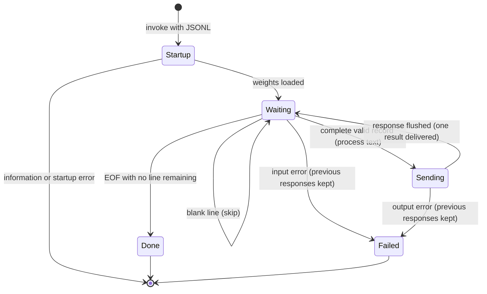

# JSONL

## Summary

`redakt --jsonl` processes a sequence of documents with one model load. Each response carries the original ID, redacted text, and the spans in that record's original text.

## The simple case

Send `{"id":"one","text":"a@example.test"}` followed by a newline. Redakt writes a JSON object with ID `"one"`, redacted text `"[EMAIL_1]"`, and an email span from 0 through 14 exclusive. It flushes that response while stdin is still open, ready for the next input line.

## The interaction, event by event

### Invoke

Pass `--jsonl`. The intended record syntax is a JSON object with exactly `id` and `text`; their order is immaterial. The ID can be any JSON value, including null, an array, or an object. Text must be a JSON string. Unknown, duplicate, or missing fields fail validation.

### Exit immediately

Information and startup errors follow the [invocation model](../foundations/invocation.md). An empty stream succeeds with no responses after loading the model.

### Begin running

Redakt reads one line at a time, skipping lines that are empty after whitespace trimming. A line must decode as UTF-8. Each nonblank line is parsed independently. A literal newline splits records, so encode a newline inside the document as an escaped newline in its JSON string.

The running CLI also accepts a two-element array in ID, text order. That representation falls outside the object syntax described in the project README. See [triage B-02](../bug-triage.md#b-02-positional-arrays-are-accepted-as-jsonl-records).

### While running

A response contains `id`, `redacted`, and `spans`. Its ID is echoed as a JSON value. It is visible in the result even if it contains text that would have matched in the document. Put private text in the `text` field and use a synthetic or opaque ID.

The span order, coordinates, and numbering follow the [document model](../foundations/documents.md). Each response is one newline-terminated JSON object and is flushed before the next line is processed. Responses arrive in input order, including for repeated IDs.

### Finish

EOF ends the stream successfully after the last record. A final line can be processed without a trailing newline. A malformed record gives `redakt: Invalid JSONL record`. A read or UTF-8 failure gives `redakt: Could not read UTF-8 JSONL`.

Either input error returns status 1, stops before any later line is processed, and leaves earlier responses available. Redakt emits no error response object. Write and flush failures also return status 1, and the final attempted response can be incomplete.

## Modifiers

| Modifier | At startup | Changed while running |
| --- | --- | --- |
| Help and version | Fast path bypasses record input. | No effect. |
| `--jsonl` | Enables per-record responses. | No effect. |
| `--weights PATH` | Selects one model for the stream. | No effect after loading. |
| Terminal or pipe | Both accept lines. A pipe allows the producer and consumer to exchange records without EOF. | EOF completes any final unterminated line. Losing the output reader can fail delivery. |

## Cancel and interrupt

| Event | At startup | While running |
| --- | --- | --- |
| Ctrl+C (once or twice) | A delivered SIGINT ends the process. | Ends the stream. Earlier responses stay with their reader. |
| SIGTERM | A delivered SIGTERM ends the process. | Ends the stream without rollback. |
| Terminal closes (SIGHUP) | A delivered SIGHUP ends the process. | Ends the stream without rollback. |
| Stdin closes (EOF) | With no buffered data the stream succeeds without responses. | Finishes the last line and then exits. |
| Stdout pipe closes | A subsequent response write can fail. | The first failed write or flush stops processing. |
| Network drops | No effect for local streams. | No effect for local streams. |
| Disk full or file inaccessible | The shell or model loader can fail. | A read or write error stops the stream. Earlier responses can remain. |
| Source file changes | Can affect redirection or model opening. | Unread input bytes can change. Already loaded weights stay in use. |
| Second invocation | Opens an independent stream. | IDs and numbering are independent. |
| Process killed outright | The process stops immediately. | Earlier responses remain and the last write can be incomplete. |

## Interactions with other systems

**Configuration.** Mode selection lasts for the invocation.

**Streams and Unicode.** JSON string escaping preserves decoded text. Offsets address decoded Unicode code points in the document.

**Exit and diagnostics.** Consumers should check the process status after reading the final response. A prefix of successful responses can be followed by a failure.

**Files and permissions.** A producer or shell controls the input file. Redakt opens no response file of its own.

**Concurrency.** Responses are in order within one invocation. Reusing an ID does not overwrite a response.

**Offline use.** Record parsing and redaction use local resources only.

## Edge cases

- An empty `text` string yields empty `redacted` and an empty span array.
- CRLF can separate input records. A blank Unicode whitespace line is ignored.
- An object split across physical lines fails even if the combined text would parse as JSON.

## Open questions and verification

- Positional arrays are accepted despite the documented object shape. The [checklist](../verification/commands.md#clijsonlmd) records the reproduction.
- The CLI specifies no maximum line length or number of records.

Verified against redakt commit `6ba6de0`
