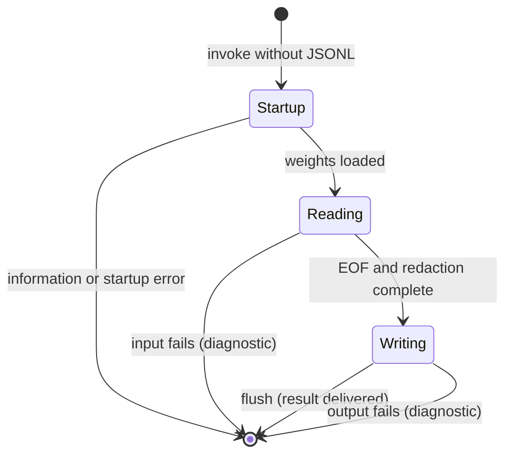

# Plain text

## Summary

The default invocation reads one UTF-8 document from stdin and returns redacted text on stdout. A shell can supply that document from a file, pipe, or terminal.

## The simple case

Run `printf 'Email: a@example.test\n' | redakt`. Redakt prints `Email:` followed by a random placeholder and the original newline. Pass `--irreversible` for the numbered label `[EMAIL_1]`. The shell sees status 0.

## The interaction, event by event

### Invoke

Omit `--jsonl`. Use stdin to supply the document. If you redirect to a file, choose a separate output path so the shell leaves the source intact.

### Exit immediately

Argument and model errors can end the invocation before any document is read. See [startup](../foundations/invocation.md#exit-immediately) and [alternate weights](weights.md).

### Begin running

After model loading, redakt starts reading stdin. There is no prompt. Even if the first line already contains a complete match, redakt waits for EOF before it detects and replaces values.

### While running

All input bytes belong to the same [document](../foundations/documents.md). A repeated value in a later line can reuse the first line's placeholder. Input can include line endings, embedded newlines, and a final line with no trailing newline.

If the input contains invalid UTF-8 or the read fails, the invocation exits 1 with `redakt: Could not read UTF-8 stdin` and sends no document output.

### Finish

On EOF, redakt detects values and saves the [encrypted recovery mapping](restore.md) before writing and flushing stdout. Pass `--irreversible` to skip recovery. An empty document succeeds with empty stdout. A document with no matches is copied. Redakt adds no newline.

A write or flush error exits 1 with the corresponding redacted-text diagnostic. Output already accepted by the destination can remain. A retry creates a new mapping by default. Reuse the same `--recovery` path to retain placeholders.

## Modifiers

| Modifier | At startup | Changed while running |
| --- | --- | --- |
| Help and version | Takes precedence if reached during parsing. | No effect. |
| `--jsonl` | Selects the [record stream](jsonl.md) in place of plain text. | No effect. |
| `--weights PATH` | Chooses the model for the document. | No effect after loading. |
| Terminal or pipe | A terminal permits interactive text entry. A pipe supplies bytes from a producer. | EOF ends the document in either case. |

## Cancel and interrupt

| Event | At startup | While running |
| --- | --- | --- |
| Ctrl+C (once or twice) | A delivered SIGINT ends the process. | Before EOF no document has been sent. During delivery some bytes may remain. |
| SIGTERM | A delivered SIGTERM ends the process. | Ends the process without rollback. |
| Terminal closes (SIGHUP) | A delivered SIGHUP ends the process. | Ends the process without rollback. |
| Stdin closes (EOF) | With no buffered data this supplies an empty document. | Starts redaction of the bytes received. |
| Stdout pipe closes | Redakt can still read the document. | A write of a nonempty result to the closed pipe can fail. |
| Network drops | No effect for local streams. | No effect for local streams. |
| Disk full or file inaccessible | The shell or model loader can fail. | A failed read yields no result. A failed write can leave partial output. |
| Source file changes | May change bytes available through redirection. | Bytes still being read can change. The result uses the bytes read. |
| Second invocation | Begins an independent document. | Numbering remains independent. |
| Process killed outright | The process stops immediately. | Only already written bytes remain. |

## Interactions with other systems

**Configuration.** Plain input needs no flags or configuration file.

**Streams and Unicode.** The full input must decode as UTF-8. Content outside replacement ranges keeps its original bytes.

**Exit and diagnostics.** Stdout is the result stream. Stderr explains ordinary failures without reproducing the document.

**Files and permissions.** Shell redirection controls file creation, truncation, and permissions.

**Concurrency.** Use separate destinations for independent results.

**Offline use.** The document and model are processed locally.

## Edge cases

- Piping multiple files into one invocation creates one document, even if the files came from separate paths.
- A downstream reader can close early and plain text mode may discover that only after EOF.
- Use JSONL when a producer needs a response before it closes stdin.

## Open questions and verification

- The specification gives no upper bound for document size or runtime. Large inputs are buffered through EOF.

Numbered-label behavior was verified against redakt commit `6ba6de0`. The current recovery workflow is covered by [CLI tests](../../../tests/recovery.rs).
