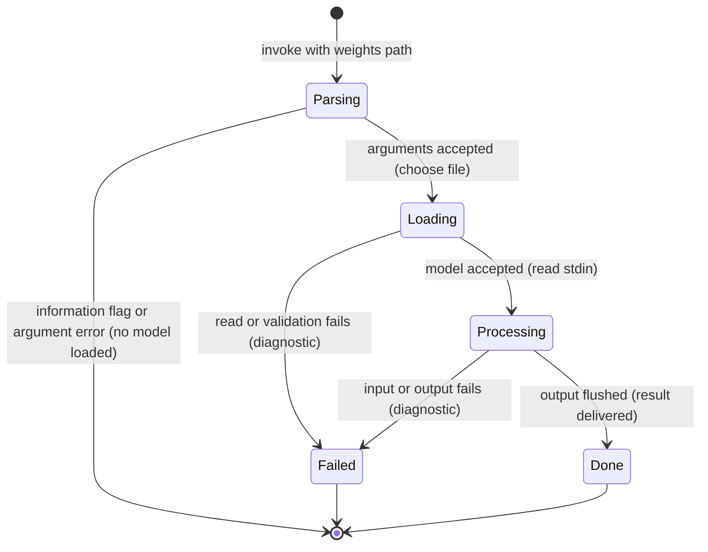

# Alternate weights

## Summary

Pass `--weights PATH` to choose the native model redakt uses to recognize values. The option works in plain text and JSONL. The executable includes a model for invocations that omit the option.

## The simple case

From the redakt checkout, pass the checked-in artifact to the release binary.

```bash
printf '%s\n' 'a@example.test' | target/release/redakt --weights models/weights.bin
```

Redakt prints `[EMAIL_1]` followed by a newline and exits 0. This file contains the same weights as the binary built from the checkout, so it produces the same result as the default. Redakt opens the file for reading and leaves its contents intact.

## The interaction, event by event



### Invoke

Give the path as a single shell argument, quoting it if it contains spaces. Relative paths start at the current directory. See [argument parsing](../foundations/invocation.md#invoke) for how redakt consumes the path token.

The artifact must use the [native version 2 format](../../ternary.md#native-format). An artifact compiled in version 1 must be recompiled.

### Exit immediately

A missing path argument is an argument error. A reached [help or version flag](information.md#exit-immediately) exits before the path is opened.

When full parsing succeeds, redakt tries the selected file before reading stdin. If it cannot read the file, it reports `redakt: Could not read native model`. An unsupported version, invalid header, or file outside the accepted size of 10 through 2,000,000 bytes reports `redakt: Unsupported native model format`. A mismatched payload size reports `redakt: Truncated or trailing native model data`. A malformed payload reports `redakt: Malformed native model`. Invalid contents can produce a more specific diagnostic, such as `redakt: Invalid head`.

All of these startup failures exit 1 without redaction output. The embedded weights are used only when no file path is selected.

### Begin running

After the model is accepted, stdin processing begins. Redakt does not print a separate success message for loading weights. In plain text mode it still waits for EOF before sending output. In JSONL mode it can respond to each line with stdin open.

### While running

The selected weights stay in use throughout the invocation. Moving the file after the first JSONL response leaves the remaining responses on the same loaded model.

File weights can change the model's detection results. The executable's [cue-based recognition](detection.md) also runs with file weights. It can still recognize a password or date of birth when the chosen model contributes no spans.

### Finish

The selected input mode determines when processing finishes. Redakt leaves the artifact as supplied. The next invocation chooses and loads its own weights.

## Modifiers

| Modifier | At startup | Changed while running |
| --- | --- | --- |
| Help and version | A reached information flag exits before opening the file. | No effect. |
| `--jsonl` | Selects record streaming after model loading. | No effect. |
| `--weights PATH` | Selects one artifact to load. Omitting it selects embedded weights. | No effect after loading. |
| Terminal or pipe | No effect on the chosen model. | No effect on the loaded model. |

## Cancel and interrupt

| Event | At startup | While running |
| --- | --- | --- |
| Ctrl+C (once or twice) | A delivered SIGINT can stop loading. | Ends processing according to the [invocation rules](../foundations/invocation.md#cancel-and-interrupt). |
| SIGTERM | A delivered SIGTERM can stop loading. | Ends processing according to the invocation rules. |
| Terminal closes (SIGHUP) | A delivered SIGHUP can stop loading. | Ends processing according to the invocation rules. |
| Stdin closes (EOF) | Redakt still loads the selected model before reading stdin. | The selected mode processes any remaining input and finishes. |
| Stdout pipe closes | No effect on loading. | A result write or flush can fail. |
| Network drops | No effect for a local artifact. | No effect on the loaded model. |
| Disk full or file inaccessible | A failed read of the selected path stops startup. A shell redirection can fail before launch. | Losing access to the artifact does not change the loaded model. Redirected output can still fail. |
| Source file changes | Loading depends on the bytes read and their validity. | Changes to the weights path apply only to later invocations. |
| Second invocation | Each invocation loads its own copy, including when they use the same path. | Each continues with its own loaded model. |
| Process killed outright | Stops loading and leaves the artifact contents intact. | Stops processing and leaves already delivered output with the reader. |

## Interactions with other systems

**Configuration.** Supply the path on every invocation that needs file weights.

**Streams and Unicode.** The path uses the platform's filename encoding. File weights can change the native model's character classification. JSONL offsets follow the [document rules](../foundations/documents.md#begin-running) regardless of the selected weights.

**Exit and diagnostics.** A failed model load produces a diagnostic on stderr without printing the path. Model acceptance alone does not mean the later document work will succeed.

**Files and permissions.** The selected path must be readable. Redakt does not need write permission on it.

**Concurrency.** Each process reads and validates its own copy. Concurrent edits during a load can affect what bytes that invocation reads.

**Offline use.** File weights and embedded weights load locally. A file path refers to a filesystem location.

## Edge cases

- A path with non-UTF-8 bytes can work on Unix if the shell passes it as one argument.
- An empty input still triggers the selected model load.
- The artifact size limit is applied after the file read. It specifies which artifacts are accepted.

## Open questions and verification

- The release binary was checked with the shipped artifact, a path containing spaces, a non-UTF-8 Unix path, and missing, legacy, truncated, and malformed artifacts.
- A JSONL invocation continued using its loaded model after the file was renamed. Behavior when the contents change during the initial read depends on the timing of the filesystem operations.

Verified against redakt commit `6ba6de0`
