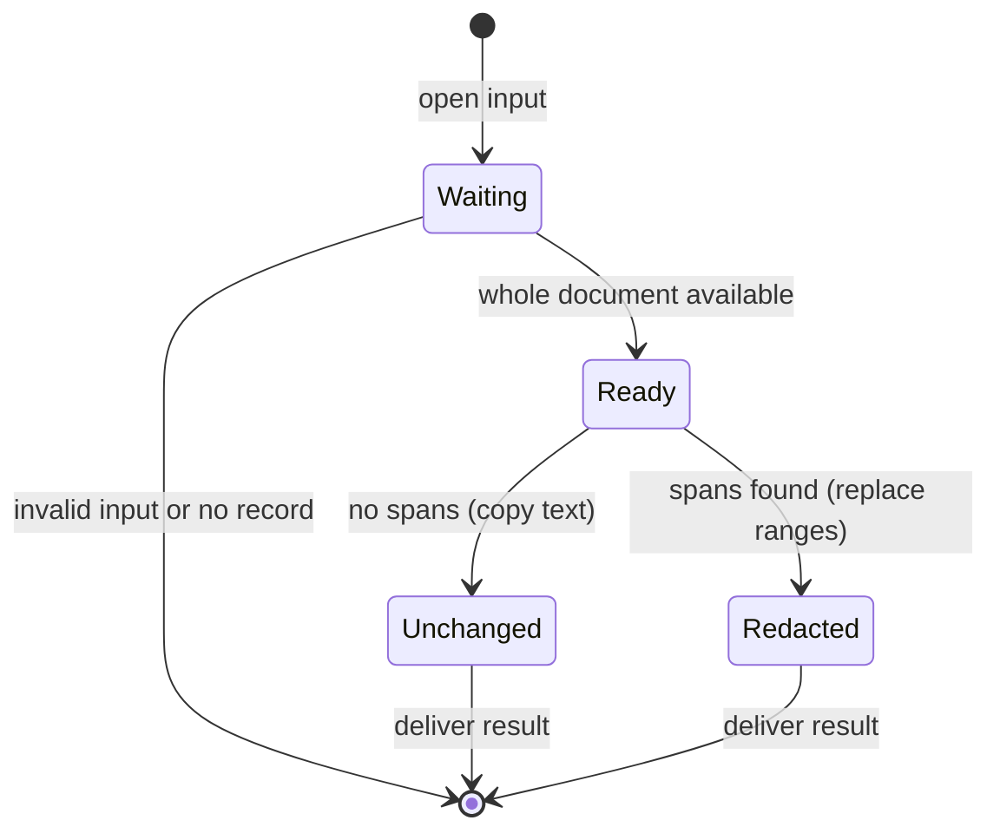

# Documents and spans

## Summary

A document is the unit of recognition. JSONL and irreversible mode number placeholders by document. Reversible redaction uses a [recovery mapping](../cli/restore.md). It is the entire plain text input or the text of one JSONL record. The result preserves all text outside the ranges replaced by placeholders.

## The simple case

In JSONL or irreversible mode, put `a@example.test b@example.test a@example.test` in a single document. The first email becomes `[EMAIL_1]`, the second becomes `[EMAIL_2]`, and the repetition becomes `[EMAIL_1]` again. A detected value in another category starts numbering in that category at 1.

## The interaction, event by event

### Invoke

The [input mode](invocation.md#invoke) chooses where the document begins and ends. Line breaks inside plain text remain part of a single document. JSONL record boundaries create distinct documents, even for repeated IDs.

### Exit immediately

Information commands, model-load failure, and rejected input produce no document result for the data in question. Plain text EOF with no bytes is an empty document. In JSONL, a blank input line is skipped, while a record with an empty text field has a response.

### Begin running

Recognition starts once the document is available. A span has `start`, `end`, and `label`. Start is zero-based and inclusive. End is exclusive. Both count Unicode code points in the original text, so an emoji before a match typically shifts the offsets by one code point even though its encoding spans multiple bytes. Combining marks count separately.

### While running

Spans are exposed in JSONL in ascending order by start, then end, then category label, with exact duplicates removed. Different categories over the same range remain distinct spans.

Redaction walks from left to right. Overlapping spans form one replacement range, including a chain of overlaps. Adjacent spans form separate ranges. The earliest span supplies the category for the range. At the same start, the longest span wins. At identical bounds, the alphabetically first label wins.

Within each uppercased category, the CLI assigns a new number to the first appearance of each distinct replaced string. It reuses the number for exact repeats in that category, including when the replaced string spans multiple overlapping detections.

### Finish

The result contains the placeholders and unchanged text. Spaces, punctuation, and line endings outside a replacement range are copied as supplied. If the document has no spans, the redacted document equals the original document. JSONL also returns the span list in original coordinates.

## Modifiers

| Modifier | At startup | Changed while running |
| --- | --- | --- |
| Help and version | Skips document processing. | No effect. |
| `--jsonl` | Defines one document per record and returns span coordinates. | No effect. |
| `--weights PATH` | Can change which native spans are found. | No effect after loading. |
| Terminal or pipe | No effect on a document with the same input bytes. | Stream closure can end input or prevent delivery. |

## Cancel and interrupt

| Event | At startup | While running |
| --- | --- | --- |
| Ctrl+C (once or twice) | See [invocation](invocation.md#cancel-and-interrupt). | A delivered signal can stop processing or delivery. |
| SIGTERM | See [invocation](invocation.md#cancel-and-interrupt). | A delivered signal can stop processing or delivery. |
| Terminal closes (SIGHUP) | See [invocation](invocation.md#cancel-and-interrupt). | A delivered signal can stop processing or delivery. |
| Stdin closes (EOF) | Can supply an empty document in plain text mode. | Ends plain text input or the JSONL stream. |
| Stdout pipe closes | Does not affect span selection. | The result can fail to reach the caller. |
| Network drops | No effect for local streams. | No effect for local streams. |
| Disk full or file inaccessible | Can prevent launch or model opening. | Can prevent document reading or output delivery. |
| Source file changes | Can change which bytes form the document. | Can affect bytes still to be read. |
| Second invocation | Creates its own documents. | Has its own numbering. |
| Process killed outright | See [invocation](invocation.md#cancel-and-interrupt). | Already delivered results remain. |

## Interactions with other systems

**Configuration.** Numbering and range rules apply with either model selection.

**Streams and Unicode.** Unicode normalization is not applied for numbering. Exact source text is used when comparing repeated values.

**Exit and diagnostics.** Input and output errors follow the [invocation contract](invocation.md#finish).

**Files and permissions.** The document can come from any readable UTF-8 stream.

**Concurrency.** There is no numbering shared between invocations or records.

**Offline use.** Recognition and replacement are local.

## Edge cases

- In JSONL, the ID is echoed separately from text. It does not participate in detection.
- A literal placeholder in the input can look identical to one redakt inserted.
- Spans are found in the original text. Inserted placeholders are not run through recognition again.

## Open questions and verification

- The Rust tests cover overlap union and bounds. The CLI checklist exercises overlapping categories and repeat numbering through synthetic stdin.

Verified against redakt commit `6ba6de0`
