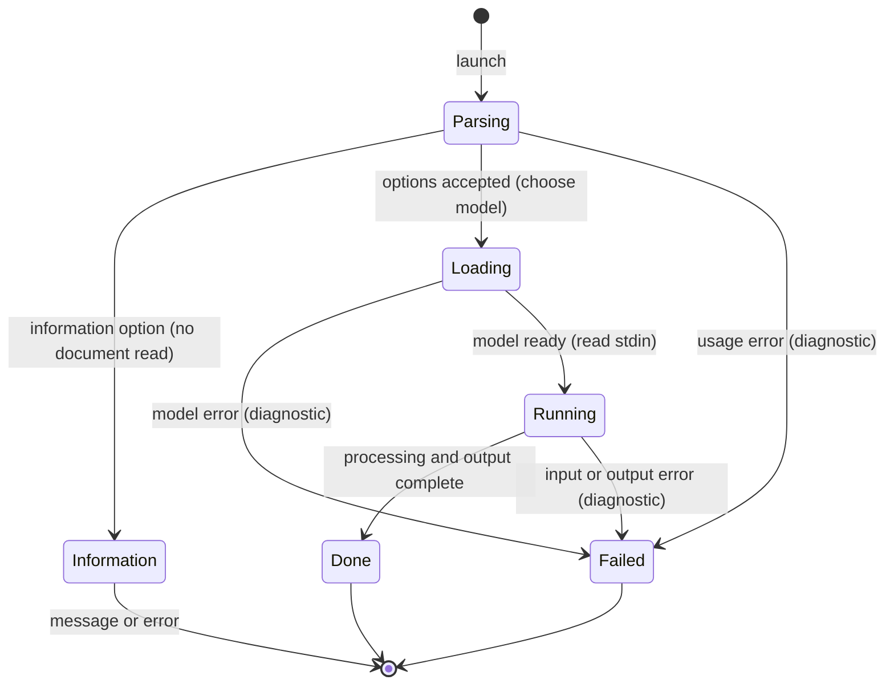

# Invocation

## Summary

Each redakt invocation handles one argument list, selects an input mode and model, and exits with a status the shell can inspect. The only document input is stdin. A filename becomes input through shell redirection or a pipe.

## The simple case

Run `redakt < input.txt > redacted.txt` from Bash with a UTF-8 input file. The shell opens the files. Redakt loads its embedded weights, reads the document, and writes the result. A successful run exits 0.

## The interaction, event by event

### Invoke

Redakt reads arguments from left to right. It accepts `--jsonl` once and `--weights PATH` once, in either order. A weights option consumes the next token verbatim as the path. Relative paths are relative to the working directory. Everything else is an error unless recognized as [help or version](../cli/information.md).

There are no subcommands, positional input filenames, built-in shell completion, or `--` end-of-options marker. Use `--weights PATH` as two tokens, without an equals sign. A flag or environment change made in the calling shell after launch does not reconfigure the process.

### Exit immediately

Help and version take the short path. An unknown or repeated option reports `Unknown or repeated argument; use --help`. A final `--weights` with no following token reports `--weights requires a path`. These failures occur before model loading and input consumption.

### Begin running

Redakt loads [weights](../cli/weights.md) before reading stdin. Plain text is the default. An explicit `--jsonl` selects the [record stream](../cli/jsonl.md).

### While running

Stdin supplies UTF-8 input, stdout carries results, and stderr carries diagnostics. There is no prompt, progress bar, color selection, log level, or built-in timeout. Streams behave the same whether a terminal or pipe is attached, subject to the terminal or pipe's own buffering and input conventions.

### Finish

Exit status 0 means the selected operation completed and writes were flushed. Exit status 1 means redakt reported an ordinary error. Diagnostics start with `redakt: ` and go to stderr without echoing the input document, JSONL record, or weights filename. Signal termination follows the shell's conventions. Check the status even if some output is present.

Redakt creates no output file itself. A shell can create or truncate a path before redakt starts, even if the invocation then fails. Use a separate destination for redacted output.

## Modifiers

| Modifier | At startup | Changed while running |
| --- | --- | --- |
| Help and version | Select the [short path](../cli/information.md). | No effect. |
| `--jsonl` | Selects record streaming. | No effect. |
| `--weights PATH` | Selects one file instead of embedded weights. | No effect. |
| Terminal or pipe | Shell wiring determines where data goes and how EOF arrives. | Closing a stream can finish input or interrupt output. |

## Cancel and interrupt

| Event | At startup | While running |
| --- | --- | --- |
| Ctrl+C (once or twice) | A delivered SIGINT ends the process. | A delivered SIGINT ends it without rollback. There is no second-stage handling. |
| SIGTERM | A delivered SIGTERM ends the process. | A delivered SIGTERM ends it without rollback. |
| Terminal closes (SIGHUP) | A delivered SIGHUP ends the process. | A delivered SIGHUP ends it without rollback. |
| Stdin closes (EOF) | The selected mode will read through buffered input to EOF. | Plain text starts processing after EOF. JSONL finishes after its final line. |
| Stdout pipe closes | A later write can fail. | A write or flush to the closed pipe reports an error. |
| Network drops | No effect for local inputs and outputs. | No effect for local inputs and outputs. |
| Disk full or file inaccessible | The shell can fail a redirection. Redakt can fail a model read. | A read, write, or flush can fail. |
| Source file changes | Results depend on what bytes can be opened and read. | No snapshot of stdin is promised. Already loaded weights stay active. |
| Second invocation | Starts independently. | Separate streams have no shared redakt state. |
| Process killed outright | The process stops immediately. | Bytes already written remain. |

> Technical note: These signal cases assume Linux and normal foreground shell handling. Redakt does not manage process groups or install an application-level cancellation protocol.

## Interactions with other systems

**Configuration.** Flags select mode and file weights. There is no redakt configuration file or environment-variable override for either selection.

**Streams and Unicode.** Inputs must be UTF-8. JSONL coordinates count code points. Filesystem path encoding is independent of the document encoding.

**Exit and diagnostics.** Stderr must be writable to receive diagnostics. The shell destination can contain partial output after an error.

**Files and permissions.** Redakt uses the calling process's permissions. The shell handles input and output redirection.

**Concurrency.** Invocations do not coordinate access to a shared destination. The caller controls how concurrent streams are combined.

**Offline use.** The executable makes no network requests or update checks during these operations.

## Edge cases

- Running the program without arguments at a terminal waits for input and EOF. The program supplies no prompt.
- An earlier parse error can prevent a later information flag from taking effect.
- A non-UTF-8 path can be used as the value of `--weights` on Unix. Option names are matched as strings.

## Open questions and verification

- An unwritable stderr can turn an ordinary error into a panic with status 101 on the tested build. See [triage B-01](../bug-triage.md#b-01-unwritable-stderr-changes-the-failure-status).
- Signal delivery and concurrent mutation of input files depend on shell and operating-system behavior. The recorded verification covers Linux.

Verified against redakt commit `6ba6de0`
