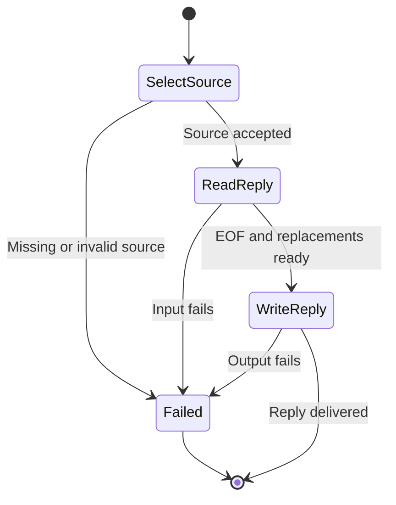

# Restore placeholders in a reply

## Summary

**Proposed.** Redact a plain-text prompt, send that copy to an AI, then replace intact placeholders in its reply on your machine. The shipping CLI redacts text and can report [spans](../foundations/documents.md). It has no restore command.

## The simple case

Redact `Draft a note to ops@example.test.` and send `Draft a note to [EMAIL_1].` Keep the restore source on your machine. If the reply includes `To: [EMAIL_1]`, pass it as plain text and explicitly select the source for that prompt. The result is `To: ops@example.test`. Review the restored reply locally because it contains the original private data.

## The interaction, event by event

### Invoke

Select restore and identify the source from one redaction. Pass the reply on stdin. Neither file needs JSONL.

### Exit immediately

A missing or invalid source fails with a diagnostic, without quoting private values or writing a result.

### Begin running

Read the reply as UTF-8 after accepting the source. A read error or invalid UTF-8 fails before output.

### While running

At EOF, replace exact known placeholders. Each occurrence receives the same original value. Unknown or altered placeholders and surrounding text stay as written.

### Finish

Write the restored reply to stdout without adding a newline. The inputs stay intact. A write failure reports an error and can leave bytes already accepted by the destination.

## Modifiers

| Modifier | At startup | Changed while running |
| --- | --- | --- |
| Help and version | Report CLI information without restoring. | No effect. |
| `--jsonl` | JSONL reply support is outside the first version. | No effect. |
| `--weights PATH` | Model selection is open if restore re-runs detection. | No effect after the source is accepted. |
| Terminal or pipe | Either can supply the plain-text reply. | EOF ends input in both cases. |

## Cancel and interrupt

| Event | At startup | While running |
| --- | --- | --- |
| Ctrl+C (once or twice) | A delivered SIGINT stops the command. | Stops the command. Delivered bytes can remain. |
| SIGTERM | A delivered SIGTERM stops the command. | Stops the command. Delivered bytes can remain. |
| Terminal closes (SIGHUP) | A delivered SIGHUP stops the command. | Stops the command. Delivered bytes can remain. |
| Stdin closes (EOF) | Supplies an empty reply when no bytes were sent. | Ends the reply. |
| Stdout pipe closes | Source validation can still complete. | Delivery can fail. |
| Network drops | No effect. | No effect. |
| Disk full or file inaccessible | An unreadable source fails before output. | A read error produces no result. A write error can leave partial output. |
| Source file changes | The source must still correspond to the redaction. The check is open. | Changes after acceptance do not alter the selected associations. |
| Second invocation | Each invocation selects its own source. | Associations stay independent. |
| Process killed outright | Stops immediately. | Stops immediately. Delivered bytes can remain. |

## Interactions with other systems

**Configuration.** Existing redaction commands retain their output. Restore is opt-in.

**Streams and Unicode.** Accept UTF-8 and preserve unaffected text and line endings.

**Exit and diagnostics.** Write restored text on stdout and errors on stderr.

**Files and permissions.** Keep the restore source local. A saved mapping would contain original private values and need access restricted to the current account.

**Concurrency.** Two redactions can both assign `[EMAIL_1]`. Only the explicitly selected source supplies the value.

**Offline use.** Restore requires no network call. Share the restored reply only where the original data belongs.

## Edge cases

- Empty replies and replies without known placeholders pass through.
- Literal placeholder text in the prompt must not cause a different value to be restored.
- An AI can add a known placeholder at a new position. Exact matching alone cannot establish its intent. Review the restored reply.

## Open questions and verification

- Choose between re-reading the original prompt and keeping a saved mapping. A mapping preserves the exact associations from the redaction run. Re-reading avoids creating a second file of secrets.
- Decide how to handle literal placeholders and detect changed prompts or detector options if restore re-runs detection.
- Choose the CLI syntax once the source is settled.

| ID | Acceptance check | Result |
| --- | --- | --- |
| RESTORE-01 | Redact a synthetic email. The outbound prompt lacks it, and restoring the reply with the chosen source brings it back. | Pending |
| RESTORE-02 | Repeat a known placeholder alongside unknown and altered ones. Only exact known placeholders change. | Pending |
| RESTORE-03 | Use two sources that both contain `[EMAIL_1]`. Each invocation restores the value from its selected source. | Pending |
| RESTORE-04 | Include Unicode and a literal placeholder in the original. Unaffected text stays intact and the literal cannot restore the wrong value. | Pending |
| RESTORE-05 | Supply a missing or invalid source. Restore fails with empty stdout and a diagnostic without private values. | Pending |

Current CLI boundary checked against source commit `d45eacc` and released redakt `0.0.6`. Restore is proposed.
